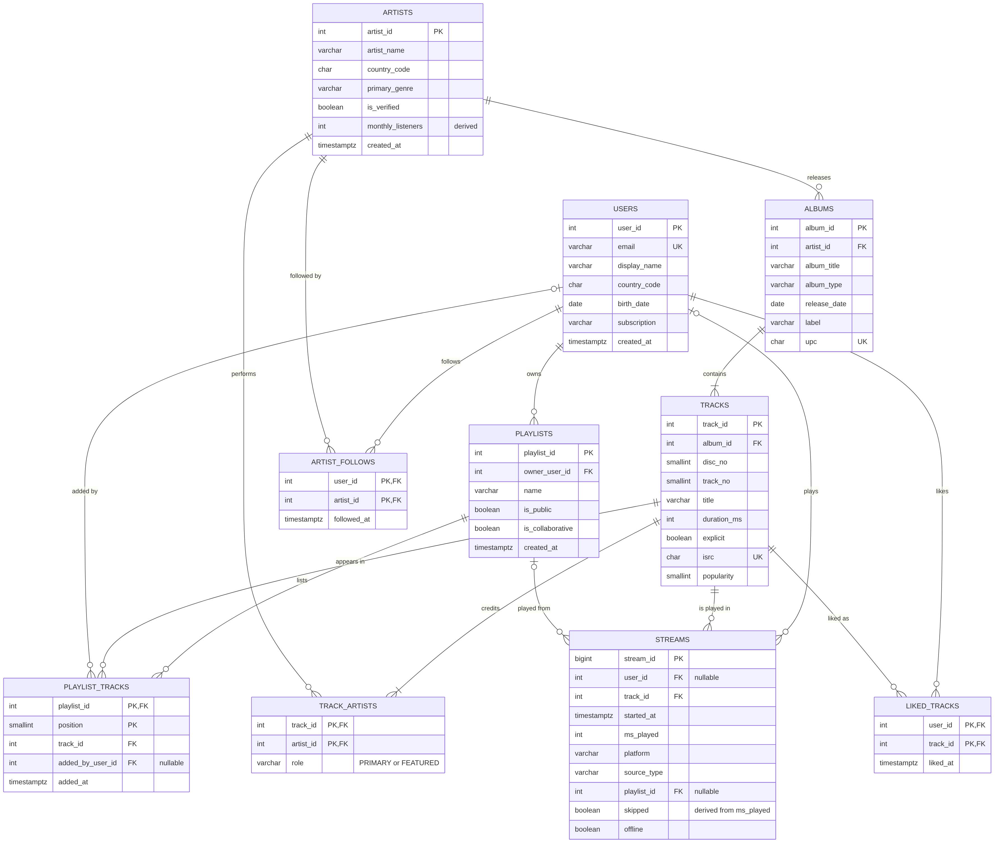
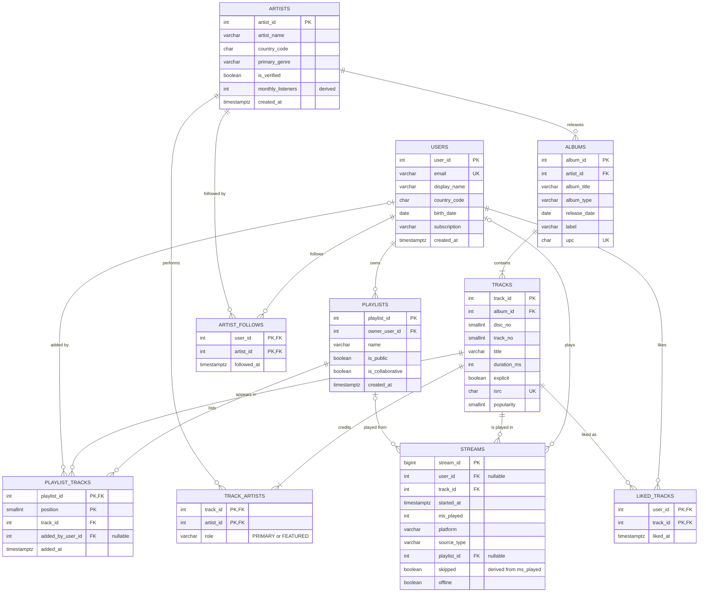

# Phase 2: Schema design (Team T0028)

Schema `spotify`, 10 tables, built only from the 10 seed CSV files. Files: `sql/01_schema.sql` (DDL),
`sql/02_load_data.sql` (load), `sql/03_integrity_checks.sql` (checks), `diagrams/er_diagram.png` (ER diagram).
Tested on PostgreSQL: the schema runs on an empty database, all 10 files load without a single error, and all
30 queries in `queries/workload_30.sql` run unchanged against it.

## 1. ER diagram

Mermaid code (also in `diagrams/er_diagram.mmd`; GitHub draws it from this block):

**Cardinalities**
| Relationship | Cardinality | How it is stored |
|---|---|---|
| artist releases album | 1 : N | `albums.artist_id` |
| album contains track | 1 : N (an album has at least one track) | `tracks.album_id` |
| track - artist (primary and featured) | M : N | `track_artists` (with `role`) |
| user owns playlist | 1 : N | `playlists.owner_user_id` |
| playlist - track | M : N, ordered, a track may repeat | `playlist_tracks` |
| user likes track | M : N | `liked_tracks` |
| user follows artist | M : N | `artist_follows` |
| user plays track | M : N, one row per play | `streams` (a fact table) |
| stream from playlist | N : 0..1 | `streams.playlist_id` (only for source `PLAYLIST`) |

## 2. Data dictionary

Types: integers sized by the data and the 20x growth plan (`stream_id` is `BIGINT`), `TIMESTAMPTZ` for every
timestamp because the export carries a `+05:30` offset, `BOOLEAN` for the `t`/`f` columns, `SMALLINT` for small
numbers, `CHAR(n)` for fixed-length codes, `VARCHAR(n)` for text. Money does not exist in this data.
`GENERATED BY DEFAULT AS IDENTITY` lets the queries insert explicit ids (W01) and new rows get fresh ones
(counters are moved past the loaded maximum in `02_load_data.sql`).

### artists
| Column | Type | Constraint | Why |
|---|---|---|---|
| artist_id | INTEGER identity | PK | surrogate key from the export |
| artist_name | VARCHAR(100) | NOT NULL, not blank | every artist has a name. Not UNIQUE: two artists can share a name in real life, even if the sample has none |
| country_code | CHAR(2) | NOT NULL, `^[A-Z]{2}$` | ISO code, fixed length |
| primary_genre | VARCHAR(30) | NOT NULL, not blank | no CHECK list of genres, because new genres appear |
| is_verified | BOOLEAN | NOT NULL, default false | yes/no flag |
| monthly_listeners | INTEGER | NOT NULL, default 0, `>= 0` | **derived** (see section 5) |
| created_at | TIMESTAMPTZ | NOT NULL | |

### albums
| Column | Type | Constraint | Why |
|---|---|---|---|
| album_id | INTEGER identity | PK | |
| artist_id | INTEGER | NOT NULL, FK artists, ON DELETE **RESTRICT** | an artist with a catalogue (and royalties) must not be deletable by accident |
| album_title | VARCHAR(200) | NOT NULL, not blank | |
| album_type | VARCHAR(11) | NOT NULL, in (ALBUM, EP, SINGLE, COMPILATION) | the four types in the data and the brief |
| release_date | DATE | NOT NULL, `>= 1900-01-01` | a date, not a time |
| label | VARCHAR(50) | NOT NULL | every album has a label (`Independent` is a value) |
| upc | CHAR(12) | NOT NULL, **UNIQUE**, 12 digits | barcode of the release: a natural candidate key |

### tracks
| Column | Type | Constraint | Why |
|---|---|---|---|
| track_id | INTEGER identity | PK | |
| album_id | INTEGER | NOT NULL, FK albums, ON DELETE **CASCADE** | a track cannot exist without its album |
| disc_no | SMALLINT | NOT NULL, default 1, `>= 1` | 2 discs exist in the data |
| track_no | SMALLINT | NOT NULL, `>= 1` | |
| title | VARCHAR(200) | NOT NULL, not blank | |
| duration_ms | INTEGER | NOT NULL, 1,000 to 3,600,000 | data is 90,008 to 329,994; a generous business range |
| explicit | BOOLEAN | NOT NULL, default false | |
| isrc | CHAR(12) | NOT NULL, **UNIQUE**, `^[A-Z]{2}[A-Z0-9]{3}[0-9]{7}$` | international recording code; rights lookups (R21) depend on it being unique |
| popularity | SMALLINT | NOT NULL, 0 to 100 | |
| | | **UNIQUE (album_id, disc_no, track_no)** | `track_no` alone repeats on disc 2 (1,017 album/number pairs, check B7), so a position is disc + number |

### track_artists
| Column | Type | Constraint | Why |
|---|---|---|---|
| track_id | INTEGER | PK part, FK tracks, ON DELETE CASCADE | credit rows die with the track |
| artist_id | INTEGER | PK part, FK artists, ON DELETE RESTRICT | |
| role | VARCHAR(8) | NOT NULL, in (PRIMARY, FEATURED) | |

Primary key is (`track_id`, `artist_id`): an artist is credited at most once on a track (0 duplicates in the data).
"Exactly one PRIMARY artist per track" cannot be written as a plain constraint without an extra index or a
trigger, so it is verified by check A3 (0 violations).

### users
| Column | Type | Constraint | Why |
|---|---|---|---|
| user_id | INTEGER identity | PK | |
| email | VARCHAR(254) | NOT NULL, **UNIQUE**, format check, must be lower case | the login identity; 254 is the maximum email length |
| display_name | VARCHAR(50) | NOT NULL, not blank | not unique: 325 distinct names for 30,000 users |
| country_code | CHAR(2) | NOT NULL, `^[A-Z]{2}$` | |
| birth_date | DATE | NOT NULL, `>= 1900-01-01` and not after the signup date | a date; needed for the under-18 rule (R12) |
| subscription | VARCHAR(7) | NOT NULL, default FREE, in (FREE, PREMIUM, FAMILY, DUO, STUDENT) | the five plans in the data |
| created_at | TIMESTAMPTZ | NOT NULL | |

### playlists
| Column | Type | Constraint | Why |
|---|---|---|---|
| playlist_id | INTEGER identity | PK | |
| owner_user_id | INTEGER | NOT NULL, FK users, ON DELETE **CASCADE** | deleting an account deletes the person's playlists |
| name | VARCHAR(100) | NOT NULL, not blank | not unique (the same owner can reuse a name) |
| is_public | BOOLEAN | NOT NULL, default false | |
| is_collaborative | BOOLEAN | NOT NULL, default false | |
| created_at | TIMESTAMPTZ | NOT NULL | |
| | | **CHECK NOT (is_public AND is_collaborative)** | a collaborative playlist cannot be public (0 violations) |

### playlist_tracks
| Column | Type | Constraint | Why |
|---|---|---|---|
| playlist_id | INTEGER | PK part, FK playlists, ON DELETE CASCADE | |
| position | SMALLINT | PK part, `>= 1` | the order inside the playlist |
| track_id | INTEGER | NOT NULL, FK tracks, ON DELETE CASCADE | if a track is removed from the catalogue it leaves every playlist (W05 does this by hand) |
| added_by_user_id | INTEGER | **nullable**, FK users, ON DELETE **SET NULL** | never NULL in the data; becomes NULL only when the person who added the track deletes their account, while the track stays in the playlist |
| added_at | TIMESTAMPTZ | NOT NULL | |

The key is (`playlist_id`, `position`), **not** (`playlist_id`, `track_id`): the same track appears twice in
a playlist in 1,800 cases (check B2, query R22), so (`playlist_id`, `track_id`) cannot be a key.

### streams
| Column | Type | Constraint | Why |
|---|---|---|---|
| stream_id | BIGINT identity | PK | the biggest table, planned to grow 20x |
| user_id | INTEGER | **nullable**, FK users, ON DELETE **SET NULL** | never NULL today. When a listener deletes their account the stream stays (royalties are paid on it) but becomes anonymous |
| track_id | INTEGER | NOT NULL, FK tracks, ON DELETE **RESTRICT** | a track with play history cannot be deleted |
| started_at | TIMESTAMPTZ | NOT NULL | |
| ms_played | INTEGER | NOT NULL, 0 to 3,600,000 | 3 streams have 0 ms (an instant skip), so the lower bound is 0, not 1 |
| platform | VARCHAR(7) | NOT NULL, in (ANDROID, IOS, WEB, DESKTOP, CAR, SPEAKER) | |
| source_type | VARCHAR(8) | NOT NULL, in (PLAYLIST, ALBUM, ARTIST, RADIO, SEARCH) | |
| playlist_id | INTEGER | **nullable**, FK playlists, ON DELETE SET NULL | NULL for 137,386 non-playlist streams. **Must stay nullable**: it is the cause of the R13 bug |
| skipped | BOOLEAN | NOT NULL | derived, see section 5 |
| offline | BOOLEAN | NOT NULL, default false | W01 inserts a stream without this column |
| | | **CHECK (source_type = 'PLAYLIST' OR playlist_id IS NULL)** | only a playlist stream carries a playlist id (0 violations). The reverse rule is not enforced because `SET NULL` would break it when a played playlist is deleted |
| | | **CHECK (skipped = (ms_played < 30000))** | keeps the stored flag in line with the 30-second rule |

### liked_tracks
| Column | Type | Constraint | Why |
|---|---|---|---|
| user_id | INTEGER | PK part, FK users, ON DELETE CASCADE | likes are personal data of the user |
| track_id | INTEGER | PK part, FK tracks, ON DELETE CASCADE | |
| liked_at | TIMESTAMPTZ | NOT NULL | |

(`user_id`, `track_id`) as the primary key is what lets W02 use `ON CONFLICT (user_id, track_id) DO NOTHING`.

### artist_follows
| Column | Type | Constraint | Why |
|---|---|---|---|
| user_id | INTEGER | PK part, FK users, ON DELETE CASCADE | |
| artist_id | INTEGER | PK part, FK artists, ON DELETE CASCADE | a follow means nothing without the artist |
| followed_at | TIMESTAMPTZ | NOT NULL | |

### Delete rules, in one line each
- **CASCADE**: things that only exist because of their parent (tracks of an album, rows of a playlist, a user's likes, follows and playlists).
- **RESTRICT**: things that carry history or money (an artist with albums, a track that has been streamed).
- **SET NULL**: optional links whose row must survive (stream of a deleted user or playlist, a track added by a deleted user).

### Constraint count
29 CHECK constraints are defined (the brief asks for at least 12) (formats of country, ISRC, UPC and email; allowed values of album
type, role, subscription, platform and source; ranges of duration, popularity, position, `ms_played`; the
collaborative and playlist rules; birth date; the skipped rule), plus 4 UNIQUE constraints and every PK and FK.
The exact list is in `sql/01_schema.sql`.

## 3. Indexes that exist (no tuning yet)
Only the ones PostgreSQL creates for PRIMARY KEY and UNIQUE constraints:
- PRIMARY KEY on every table (the two link tables and `playlist_tracks` have composite keys)
- UNIQUE: `albums(upc)`, `tracks(album_id, disc_no, track_no)`, `tracks(isrc)`, `users(email)`

Foreign-key columns have **no index yet** (for example `streams.track_id`, `streams.user_id`,
`track_artists.artist_id`). That is deliberate: the Phase 3 baseline must be untuned.

## 4. Functional dependencies and normal form

| Table | Key | Functional dependencies | Normal form |
|---|---|---|---|
| artists | artist_id | artist_id -> every other column | BCNF (see the derived column below) |
| albums | album_id; also upc | album_id -> all; upc -> all | BCNF (two candidate keys, each determines everything) |
| tracks | track_id; also isrc; also (album_id, disc_no, track_no) | each candidate key -> all columns | BCNF |
| track_artists | (track_id, artist_id) | (track_id, artist_id) -> role | BCNF |
| users | user_id; also email | each key -> all columns | BCNF |
| playlists | playlist_id | playlist_id -> all | BCNF |
| playlist_tracks | (playlist_id, position) | (playlist_id, position) -> track_id, added_by_user_id, added_at | BCNF |
| streams | stream_id | stream_id -> all columns | 3NF/BCNF for the stored facts, see the derived column below |
| liked_tracks | (user_id, track_id) | -> liked_at | BCNF |
| artist_follows | (user_id, artist_id) | -> followed_at | BCNF |

Each table has atomic values (1NF), no partial dependency because every composite key has only non-key
attributes that depend on the whole key (2NF), and no non-key attribute depends on another non-key attribute
(3NF). `label` in `albums` is a plain text column with 8 values; it would be a separate table in a larger system, but no
dependency `label -> something` exists in the data (there are no label attributes), so the table is still in 3NF.

## 5. Derived and redundant columns (and whether to keep them)

| Column | Redundant with | Keep? | Reason |
|---|---|---|---|
| `artists.monthly_listeners` | `count(DISTINCT user_id)` of streams in the last 28 days of the artist's tracks (query R16, written by the nightly job W04) | **Yes, as a cache** | In the data it equals the real value for all 3,000 artists (check A12 = 0). Artist pages read it constantly; recomputing 28 days of streams on each page view is far too slow. Cost: W04 must run every night or the number goes stale. |
| `streams.skipped` | `ms_played < 30000`, exactly. Skipped streams max out at 28,999 ms, non-skipped start at 55,899 ms; no row disagrees | **Yes, with a CHECK** | Saves a computation in the skip-rate query R08. The CHECK prevents the two columns from ever disagreeing, which removes the update-anomaly risk of redundancy. |
| `track_artists` PRIMARY row vs `albums.artist_id` | the primary artist of a track is always the artist of its album (0 exceptions, A4) | **Yes** | The primary row is how R01, R07 and R09 find "all tracks of an artist". The album artist alone would miss featured credits and compilations in the future. Cost: two places to update if an album changes its artist. |

## 6. Row counts after loading
| Table | Rows | Expected |
|---|---:|---:|
| artists | 3,000 | 3,000 |
| albums | 12,000 | 12,000 |
| tracks | 67,808 | 67,808 |
| track_artists | 77,489 | 77,489 |
| users | 30,000 | 30,000 |
| playlists | 10,000 | 10,000 |
| playlist_tracks | 120,004 | 120,004 |
| streams | 250,000 | 250,000 |
| liked_tracks | 58,533 | 58,533 |
| artist_follows | 69,901 | 69,901 |

## 7. Integrity checks (`sql/03_integrity_checks.sql`)

**A. Rules the data obeys (all must be 0)**
| Check | Violations |
|---|---:|
| A1 nobody streamed a track before its album was released | 0 |
| A2 `ms_played` never exceeds the track duration | 0 |
| A3 every track has exactly one PRIMARY artist | 0 |
| A4 the PRIMARY artist of a track is the artist of its album | 0 |
| A5 a featured artist is never also the primary artist of the same track | 0 |
| A6 playlist positions run 1..n with no gaps | 0 |
| A7 a stream that names a playlist plays a track that is in that playlist | 0 |
| A8 only collaborative playlists have tracks added by someone other than the owner | 0 |
| A9 no stream happens before the listener created the account | 0 |
| A10 no like happens before the listener created the account | 0 |
| A11 no stream is older than the playlist it was played from | 0 |
| A12 stored `monthly_listeners` equals the real distinct listeners of the last 28 days | 0 |

## 8. Data problems we found
| # | Problem | Rows | What we did |
|---|---|---:|---|
| B1 | A follow is dated **before** the follower created the account | 12,840 | Not a CHECK (the data would be rejected). Reported as a data-quality issue; the columns are kept as exported. |
| B8 | A playlist is dated **before** its owner created the account | 3,097 | Same as B1. |
| B3 | Users who were **under 13** when they signed up (13 is the usual minimum age for a streaming account), because `birth_date` is as late as 2014 | 6,662 | Kept. It matters for the compliance query R12 (under-18 streams). The only CHECK on `birth_date` is "not after signup". |
| B2 | The same track appears **more than once** in one playlist | 1,800 pairs | This is why (`playlist_id`, `track_id`) is not the key of `playlist_tracks`. Query R22 finds them. |
| B7 | `track_no` alone repeats within an album because of disc 2 | 1,017 | The uniqueness rule is (`album_id`, `disc_no`, `track_no`). |
| B4 | Streams with `ms_played = 0` | 3 | Allowed: an instant skip. The lower bound is 0. |
| B5 | `streams.playlist_id` is NULL for non-playlist plays | 137,386 | Correct and needed. But it makes **R13** (`NOT IN` over this column) return no rows at all, because `x NOT IN (..., NULL)` is never true. R13 is the "wrong-result query" for Phase 4. |
| B6 | Public playlists really never played (the correct answer to R13) | 1,891 | R13 as written returns 0 rows instead of 1,891. To be fixed with `NOT EXISTS` in Phase 4, and proven equal in the optimization report. |

Run the checks with `psql -d <db> -f sql/03_integrity_checks.sql`.

## 9. Assumptions and limits
- Genre, label and country are free text with format checks only; lists of allowed values would block new data.
- "At least one track per album" and "exactly one PRIMARY artist per track" cannot be written as plain constraints; they are verified by checks (A3) and would need triggers in production.
- The ER diagram is drawn from the final DDL (`sql/01_schema.sql`).
